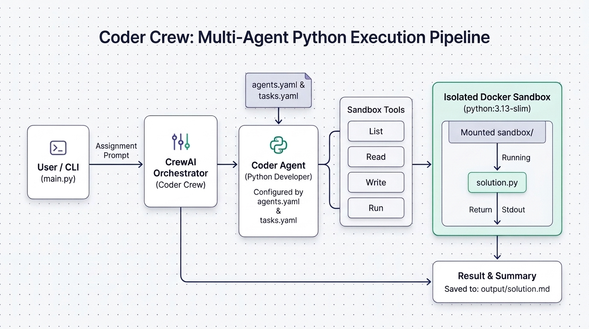
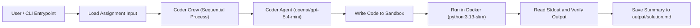
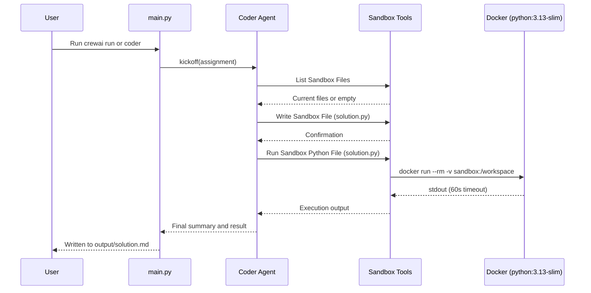

# Coder Crew

An autonomous Python coding assistant built with **CrewAI** that writes, inspects, and executes Python programs inside an isolated **Docker sandbox**. Given a natural-language assignment, the agent authors code in a dedicated sandbox workspace, runs it inside an ephemeral `python:3.13-slim` container, verifies the output, and saves a structured Markdown report.

---

## Architecture Overview



### Execution Pipeline



---

## How It Works

1. **Assignment Input**: `src/coder/main.py` defines an `assignment` string (by default, computing the first 1,000,000 terms of the Leibniz series `1 - 1/3 + 1/5 - 1/7 + ...` multiplied by `4` to approximate $\pi$) and passes it to the crew via `kickoff(inputs={'assignment': assignment})`.
2. **Crew Orchestration**: `src/coder/crew.py` defines the `@CrewBase` class `Coder`, which wires together the `coder` agent and `coding_task` using `Process.sequential` with `verbose=True` and `tracing=True`.
3. **Agent & Task Configuration**:
   - **Agent (`coder`)**: Configured in `src/coder/config/agents.yaml` as a *Python Developer* powered by `openai/gpt-5.4-mini`, equipped with `sandbox_tools`.
   - **Task (`coding_task`)**: Configured in `src/coder/config/tasks.yaml` to write and run Python code in the sandbox and output a final summary to `output/solution.md`.
4. **Isolated Docker Execution**: Every script execution runs in a fresh container (`docker run --rm`) using `python:3.13-slim` with the local `sandbox/` folder mounted at `/workspace` and a 60-second timeout.

### Sandbox Interaction Sequence



---

## Sandbox Tools Reference

All tools exposed to the agent in `src/coder/tools/sandbox_tools.py` opt out of CrewAI's default tool caching (`cache_function` returns `False`) so the agent never reads stale filesystem or execution state.

| Tool Name | Function | Description |
| :--- | :--- | :--- |
| **List Sandbox Files** | `list_sandbox_files()` | Returns a sorted, newline-separated list of filenames in `sandbox/`, or indicates that the sandbox is empty. |
| **Read Sandbox File** | `read_sandbox_file(filename)` | Reads and returns the text contents of a file in `sandbox/`, or reports if it does not exist. |
| **Write Sandbox File** | `write_sandbox_file(filename, content)` | Writes or overwrites a file in `sandbox/` and returns the character count written. |
| **Run Sandbox Python File** | `run_sandbox_python(filename)` | Executes the specified Python file inside `python:3.13-slim` with `sandbox/` mounted to `/workspace`, returning `stdout` (60s timeout). |

---

## Prerequisites

- **Python**: `>=3.10, <3.14`
- **uv** (recommended) or `pip` for dependency management (`crewai[tools]==1.14.4`)
- **Docker**: Docker Engine installed and accessible to the current user (the `python:3.13-slim` image will be pulled automatically on first run)
- **API Key**: An `OPENAI_API_KEY` set in your environment or `.env` file (required by `openai/gpt-5.4-mini`)

---

## Setup & Installation

Using `uv` (recommended):

```bash
uv sync
```

Or using a standard virtual environment:

```bash
python3 -m venv .venv
source .venv/bin/activate
pip install -e .
```

Add your OpenAI API key to a `.env` file in the project root:

```env
OPENAI_API_KEY=your_openai_api_key_here
```

---

## Running the Project

### Default Run

Execute the crew using the CrewAI CLI or the project scripts defined in `pyproject.toml`:

```bash
crewai run
```

Alternatively, with `uv` or the virtual environment:

```bash
uv run coder
# or
uv run run_crew
```

After execution completes:
- Generated Python code is saved in `sandbox/` (for example, `sandbox/solution.py`).
- The agent's summary and execution result are written to `output/solution.md`.

### Customizing the Assignment

Update the `assignment` variable in `src/coder/main.py` to give the agent a different coding task, or customize the agent's role, goal, backstory, and LLM model in `src/coder/config/agents.yaml`.

### Additional CLI Entrypoints

`pyproject.toml` exposes standard CrewAI lifecycle scripts:

| Command | Entrypoint | Purpose |
| :--- | :--- | :--- |
| `coder` / `run_crew` | `coder.main:run` | Run the crew with the configured assignment |
| `train` | `coder.main:train` | Train the crew over `n_iterations` |
| `replay` | `coder.main:replay` | Replay execution from a specific `task_id` |
| `test` | `coder.main:test` | Evaluate the crew over `n_iterations` |
| `run_with_trigger` | `coder.main:run_with_trigger` | Kick off the crew with a JSON trigger payload |

---

## Troubleshooting

| Issue | Cause | Solution |
| :--- | :--- | :--- |
| `ModuleNotFoundError: No module named 'crewai'` | Dependencies are not installed or the virtual environment is not active | Run `uv sync` or activate `.venv` and run `pip install -e .` |
| Docker permission or daemon error | Docker daemon is not running or user lacks permission | Start Docker and ensure your user is in the `docker` group |
| Empty output from `run_sandbox_python` | Script raised an exception to `stderr` or printed nothing | Check `stderr` or ensure the script prints its final result to `stdout` |
| Authentication error from LLM | Missing or invalid `OPENAI_API_KEY` | Verify `OPENAI_API_KEY` in `.env` or your shell environment |

